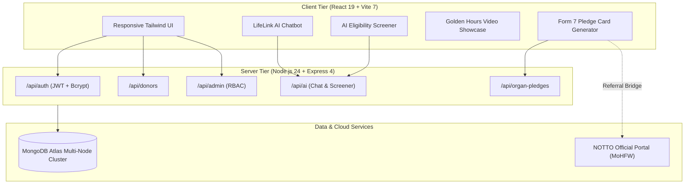
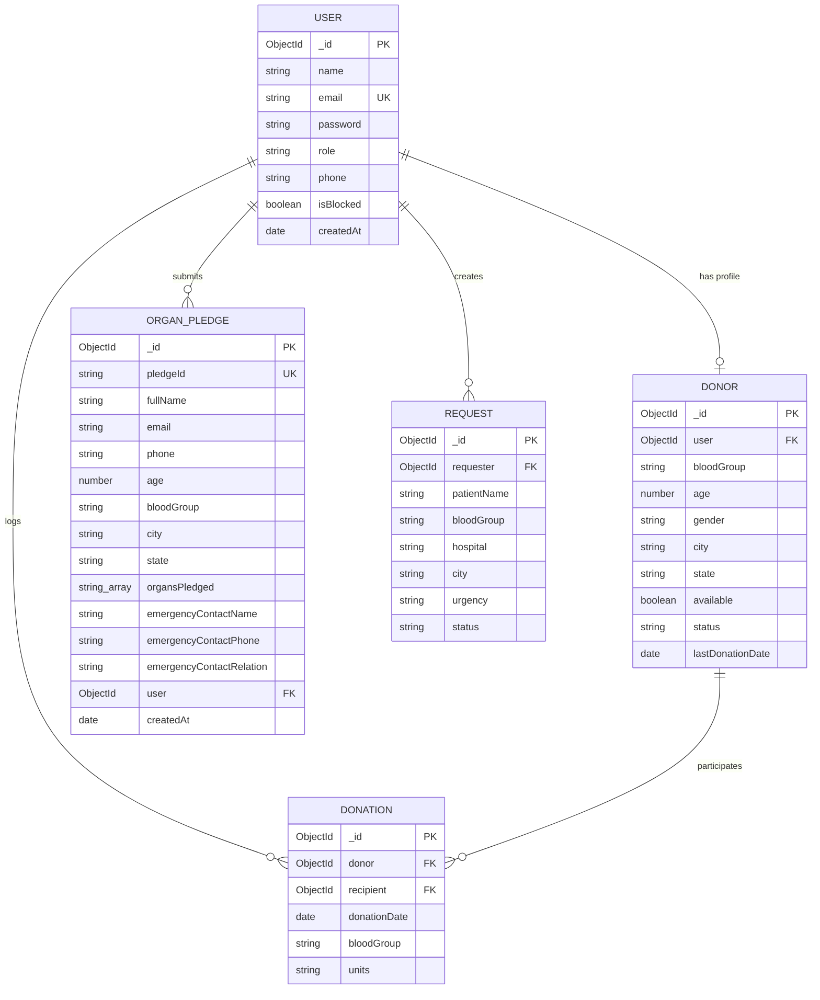

# Software Requirements Specification (SRS)
## LifeLink: AI-Powered Blood and Organ Donation Management System
### Integrated with NOTTO (National Organ & Tissue Transplant Organization, MoHFW, Govt. of India)

---

**Document Version:** 1.0.0  
**Status:** Approved / Release Baseline  
**Date:** November 2026  
**Standard:** Compliant with IEEE Std 830-1998  
**Project:** Entri Main Project — Full-Stack MERN Health-Tech Solution  

---

## Table of Contents
1. [Introduction](#1-introduction)
   - 1.1 Purpose
   - 1.2 Document Conventions
   - 1.3 Intended Audience & Reading Suggestions
   - 1.4 Product Scope
   - 1.5 References
2. [Overall Description](#2-overall-description)
   - 2.1 Product Perspective
   - 2.2 System Architecture
   - 2.3 Product Functions & Major Modules
   - 2.4 User Classes & Personas
   - 2.5 Operating Environment
   - 2.6 Design & Implementation Constraints
   - 2.7 Assumptions & Dependencies
3. [External Interface Requirements](#3-external-interface-requirements)
   - 3.1 User Interfaces (UI/UX)
   - 3.2 Hardware Interfaces
   - 3.3 Software Interfaces
   - 3.4 Communication Protocols & Interfaces
4. [System Features & Functional Requirements](#4-system-features--functional-requirements)
   - 4.1 Module 1: Authentication & Authorization (RBAC)
   - 4.2 Module 2: Blood Donor Directory & Emergency Search
   - 4.3 Module 3: National Organ Donation Module (NOTTO Integration)
   - 4.4 Module 4: Interactive Golden Hours Video Showcase
   - 4.5 Module 5: AI Donor Eligibility Pre-Screening Engine
   - 4.6 Module 6: LifeLink AI Health Assistant (Chatbot)
   - 4.7 Module 7: Administrative Governance & Oversight
5. [Database Schema & Data Architecture](#5-database-schema--data-architecture)
   - 5.1 Entity-Relationship Diagram (ERD)
   - 5.2 Collections & Schema Specifications
6. [Non-Functional Requirements (NFRs)](#6-non-functional-requirements-nfrs)
   - 6.1 Performance Requirements
   - 6.2 Security & Data Privacy Requirements
   - 6.3 Safety & Medical Disclaimers
   - 6.4 Usability & Accessibility (WCAG 2.1)
   - 6.5 Maintainability & Reliability
7. [Regulatory & Statutory Compliance](#7-regulatory--statutory-compliance)
   - 7.1 Transplantation of Human Organs and Tissues Act (THOTA 1994 & Amendments)
   - 7.2 National Blood Transfusion Council (NBTC) Criteria
   - 7.3 Digital Personal Data Protection (DPDP) Act, India (2023)
8. [Verification, Validation & Acceptance Criteria](#8-verification-validation--acceptance-criteria)

---

## 1. Introduction

### 1.1 Purpose
This Software Requirements Specification (SRS) provides a comprehensive, formal specification of the requirements for the **LifeLink Blood and Organ Donation Platform**. It delineates the functional, non-functional, behavioral, data, and regulatory interfaces of the system. This document serves as the primary agreement between stakeholders, developers, software quality assurance engineers, and evaluators.

### 1.2 Document Conventions
* **Requirement Identifiers:** 
  * `FR-xxx`: Functional Requirement
  * `NFR-xxx`: Non-Functional Requirement
  * `SEC-xxx`: Security Requirement
  * `REG-xxx`: Regulatory/Statutory Requirement
* **Typographical Conventions:** Bold text indicates UI elements, system states, or key terms; monospace font represents file paths, database attributes, code entities, and API endpoints.
* **Priority Levels:** Rated as **High (Mandatory / P1)**, **Medium (Essential / P2)**, or **Low (Desirable / P3)**.

### 1.3 Intended Audience & Reading Suggestions
* **System Architects & Engineers:** Focus on Sections 2, 4, 5, and 6.
* **Project Reviewers & Academic Evaluators:** Review Sections 1, 2, 4, 7, and 8.
* **Clinical & Quality Assurance Specialists:** Focus on Sections 4.4, 4.5, 4.6, 6, and 7.

### 1.4 Product Scope
LifeLink is an end-to-end, full-stack MERN (MongoDB, Express.js, React.js 19, Node.js 24) healthcare portal engineered to resolve acute organ and blood shortages across India. The software combines:
1. Voluntary blood donor registration, geographic search, and emergency patient-donor connection.
2. Official integration with **NOTTO (National Organ & Tissue Transplant Organization, MoHFW, Government of India)** under the *Transplantation of Human Organs and Tissues Act (THOTA)*.
3. An interactive, browser-based **Cinematic Golden Hours Video Showcase** illustrating ischemic organ preservation windows (Heart 4-6h, Liver 8-15h, Kidneys 24-36h, Corneas 6h, Platelets 5 days) with Web Speech API audio narration.
4. An **AI Donor Eligibility Pre-Screening Engine** that evaluates donor parameters (age, weight, 6-month tattoo interval, 24h alcohol restriction, acute antibiotic therapy, insulin use) to generate instant clinical scores and deferral timelines.
5. A 24/7 **LifeLink AI Health Assistant** chatbot trained on NBTC and NOTTO standards.
6. A robust **Administrative Governance Dashboard** for profile approvals, pledge audits, and data governance.

### 1.5 References
1. IEEE Std 830-1998: *IEEE Recommended Practice for Software Requirements Specifications*.
2. *Transplantation of Human Organs and Tissues Act (THOTA)*, 1994, Act No. 42 of 1994, Ministry of Law and Justice, Government of India.
3. National Organ & Tissue Transplant Organization (NOTTO): *National Organ Donor Register & Guidelines*, Ministry of Health and Family Welfare (MoHFW), Govt. of India (`https://notto.mohfw.gov.in/donor-pledge`).
4. National Blood Transfusion Council (NBTC) / National AIDS Control Organization (NACO): *Voluntary Blood Donation Guidelines & Donor Selection Criteria*, Govt. of India.
5. Digital Personal Data Protection Act (DPDP), 2023, Ministry of Electronics and Information Technology (MeitY), Government of India.

---

## 2. Overall Description

### 2.1 Product Perspective
LifeLink operates as a distributed web application utilizing a modern client-server architecture:
* **Presentation Layer:** React 19 single-page application (SPA) scaffolded with Vite 7 and styled using Tailwind CSS v4.
* **Application / Business Logic Layer:** RESTful API micro-services powered by Express.js 4 on Node.js v24.
* **Data Layer:** Cloud-hosted MongoDB Atlas cluster with automatic failover, replica sets, and strict schema validation via Mongoose ODM.
* **External Government Services:** Outbound referral bridge to the official MoHFW NOTTO National Organ Donor Registry.

### 2.2 Product Functions & Major Modules
The system is partitioned into six core functional pillars:
1. **Donor Discovery & Matching:** Search verified donors by ABO/Rh blood groups, metropolitan city/state, and instant availability flag.
2. **National Organ Pledge Registry:** Facilitates organ/tissue pledges (Heart, Kidneys, Liver, Lungs, Pancreas, Intestines, Corneas, Skin/Tissues) with statutory next-of-kin legal consent recording and instant Form 7 pledge card generation.
3. **Medical Golden Hours Educational Showcase:** Interactive 7-scene presentation demonstrating cold ischemic organ preservation windows, transport constraints (Green Corridors), and browser voice narration.
4. **AI Clinical Pre-Screening Screener:** Validates medical criteria (vitals, tattoo/piercing interval, medications, donation interval) providing a 0–100% readiness score and tailored deferral guidance.
5. **Conversational Clinical AI:** Natural language Q&A engine resolving donor inquiries, myth busting, and emergency assistance routing.
6. **Administrative Governance:** Moderation queue to verify donor credentials, monitor NOTTO pledges, block bad actors, and track impact metrics.

### 2.3 User Classes & Personas
| User Class | Description | Primary Capabilities |
| :--- | :--- | :--- |
| **Public Visitor / Recipient** | General public, patient relatives, or trauma attendants. | Search verified blood donors, view organ viability timelines, run AI eligibility screener, chat with AI guide. |
| **Voluntary Blood Donor** | Healthy citizens aged 18–65 volunteering blood. | Register donor profile, log blood group, update availability, track donation records. |
| **Organ Pledger** | Citizens wishing to pledge organs after death. | Submit organ/tissue pledge, generate printable Form 7 donor card, connect with NOTTO. |
| **System Administrator** | Authorized personnel and medical moderators. | Approve/reject donor profiles, inspect NOTTO pledges, manage user accounts, inspect system statistics. |

### 2.4 Operating Environment
* **Server Environment:** Node.js v20.0+ (Tested on v24.14.0), Express 4.x, running on Linux/Windows Server with public DNS resolvers (`8.8.8.8`, `8.8.4.4`).
* **Database Environment:** MongoDB 7.0+ on MongoDB Atlas with TLS 1.3 encryption-in-transit and AES-256 encryption-at-rest.
* **Client Environment:** Modern evergreen web browsers (Google Chrome 110+, Mozilla Firefox 115+, Microsoft Edge 110+, Apple Safari 16+), responsive across mobile (360px+), tablet, and desktop (1920px+).

### 2.5 Design & Implementation Constraints
1. **DNS SRV Resolution on Windows:** Client networks using standard router DNS frequently refuse `_mongodb._tcp` queries (`querySrv ECONNREFUSED`). The backend explicitly enforces trusted DNS servers (`dns.setServers(['8.8.8.8', '8.8.4.4'])`).
2. **Statutory THOTA Compliance:** In India, organ pledge cards are expressions of intent; legal custody remains with the next-of-kin at the time of death. The system mandates collecting next-of-kin details.
3. **Zero Medical Liability Constraint:** The platform provides connectivity, educational simulation, and screening; it explicitly disclaims real-time diagnostic liability and displays the 24x7 NOTTO helpline (**`1800-11-4770`**) and ambulance emergency (**`108`**).

---

## 3. External Interface Requirements

### 3.1 User Interfaces (UI/UX)
* **Design System:** Responsive Tailwind CSS v4 design system utilizing a medical red-and-slate palette (`#dc2626`, `#0f172a`, `#f8fafc`).
* **Hero Banner & Metrics:** Displays national stats (1 Deceased Donor = 8 Lives Saved, 4-6h heart preservation window, 5-day platelet perishability) and emergency helplines.
* **Cinematic Video Showcase:** Integrated media player with custom SVG organ graphics, timer countdown simulations, progress scrubber, and SpeechSynthesis voice toggle.
* **Interactive Viability Catalog:** Category-filtered grid (Solid Organs, Tissues, Blood Components) with real-time temperature and clinical significance deep-dive cards.
* **Pledge Card Canvas:** Realistic dual-tone digital card featuring Government of India / NOTTO insignia, donor QR/ID code, blood group, and 1-click `window.print()` functionality.
* **Floating AI Bot:** Fixed bottom-right modal with expandable glassmorphic chat container, suggested prompt pills, and real-time streaming states.

### 3.2 Hardware Interfaces
No specialized hardware required. Standard client hardware supporting modern web rendering engines and audio output devices (for Web Speech API narration).

### 3.3 Software Interfaces
* **MongoDB Atlas Database:** Connected via Mongoose ODM over TLS/SSL connection string.
* **Web Speech Synthesis API:** Native browser speech engine (`SpeechSynthesisUtterance`) leveraged for educational video narration and AI assistant speech.
* **NOTTO Portal Referral Interface:** External secure redirection bridge linking users to `https://notto.mohfw.gov.in/donor-pledge`.

### 3.4 Communication Protocols & Interfaces
* **Transport Protocol:** HTTPS / TLS 1.3 for all client-to-server and server-to-database communications.
* **Data Interchange Format:** Standardized JSON (`application/json`) payload architecture.
* **Cross-Origin Resource Sharing (CORS):** Strict origin filtering configured via `CLIENT_URL` environment variables.

---

## 4. System Features & Functional Requirements

### 4.1 Module 1: Authentication & Authorization (RBAC)
* **FR-AUTH-01:** System shall permit users to register with name, email, password (min 6 characters), and contact telephone.
* **FR-AUTH-02:** System shall hash passwords using `bcryptjs` with salt round factor >= 10 prior to persistence.
* **FR-AUTH-03:** System shall issue stateless JSON Web Tokens (JWT) containing user ID and role claims, expiring after 10 days.
* **FR-AUTH-04:** Middleware `protect` shall intercept private endpoints, verify JWT integrity, and attach active user instances.
* **FR-AUTH-05:** Middleware `authorize('admin')` shall restrict administrative endpoints from non-admin accounts.

### 4.2 Module 2: Blood Donor Directory & Emergency Search
* **FR-DON-01:** System shall enable registered users to create a donor profile containing blood group (`A+`, `A-`, `B+`, `B-`, `AB+`, `AB-`, `O+`, `O-`), age (18–65), gender, city, state, bio, and availability status.
* **FR-DON-02:** New donor profiles shall default to `pending` status until verified by an administrator.
* **FR-DON-03:** System shall provide search filters for Blood Group, City (case-insensitive partial match), and Availability toggle (`available=true`).
* **FR-DON-04:** Approved donors shall have public profile cards displaying their blood group badge, verified city, and masked contact methods.

### 4.3 Module 3: National Organ Donation Module (NOTTO Integration)
* **FR-ORG-01:** System shall provide an interactive multi-select organ pledge selector for: Heart, Kidneys, Liver, Lungs, Pancreas, Intestines, Corneas (Eyes), Skin & Tissues, Heart Valves & Bone, or "All Organs & Tissues".
* **FR-ORG-02:** System shall enforce mandatory next-of-kin legal contact capture (Name, Mobile, Relationship) in compliance with THOTA Form 7 norms.
* **FR-ORG-03:** System shall generate an immutable, unique national tracking reference ID formatted as `NOTTO-LL-XXXXX`.
* **FR-ORG-04:** System shall render a digital, high-fidelity **National Organ Donor Pledge Card** with printable styles (`@media print`).
* **FR-ORG-05:** System shall maintain an outbound referral bridge with 1-click deep-link redirection to the official Government of India NOTTO registry (`https://notto.mohfw.gov.in/donor-pledge`).

### 4.4 Module 4: Interactive Golden Hours Video Showcase
* **FR-VID-01:** System shall present a 7-scene cinematic visualizer detailing organ preservation windows:
  1. *Scene 1: Introduction* (500,000+ national waitlist; 1 blood need every 2s).
  2. *Scene 2: Heart & Lungs* (4–6 hours preservation at 4°C; Green Corridor transit).
  3. *Scene 3: Liver & Pancreas* (8–15 hours preservation; split-liver adult/infant graft capability).
  4. *Scene 4: Kidneys* (24–36 hours static storage; up to 48 hours with machine perfusion; liberation from dialysis).
  5. *Scene 5: Corneas & Tissues* (Retrieved within 6 hours of cardiac death; stored 14 days to 5 years).
  6. *Scene 6: Blood & Platelets* (Platelet 5-day expiration emergency; RBC 42-day shelf life).
  7. *Scene 7: Finale* (1 donor saves 8 lives; NOTTO pledge call to action).
* **FR-VID-02:** System shall support interactive video controls: Play/Pause, Next Chapter, Previous Chapter, Replay, Fullscreen, and Scrubber Timeline.
* **FR-VID-03:** System shall integrate a toggleable SpeechSynthesis voice engine narrating clinical details synchronously with active chapters.

### 4.5 Module 5: AI Donor Eligibility Pre-Screening Engine
* **FR-SCR-01:** System shall accept user screening parameters: Age, Weight (kg), Gender, Blood Group, Tattoo/Piercing (<= 6 months), Alcohol (<= 24 hours), Smoking (<= 2 hours), Antibiotics (<= 7 days), Major Surgery (<= 6 months), Insulin Diabetes (yes/no), Hypertension status, and Days Since Last Donation.
* **FR-SCR-02:** API endpoint `/api/ai/screen-eligibility` shall calculate a clinical readiness score (0–100%) and assign status: `Eligible to Donate Blood Today ✅` or `Temporary Deferral ⏳`.
* **FR-SCR-03:** Engine shall compute exact remaining recovery intervals (90 days for males, 120 days for females).
* **FR-SCR-04:** Engine shall provide clinical recommendations regarding hydration and iron nutrition.
* **FR-SCR-05:** Engine shall explicitly notify deferred blood donors that organ pledge eligibility via NOTTO remains 100% active.

### 4.6 Module 6: LifeLink AI Health Assistant (Chatbot)
* **FR-BOT-01:** Chatbot shall float persistently on all client viewports with notification badges.
* **FR-BOT-02:** Chatbot shall resolve queries against an embedded clinical knowledge base incorporating NBTC and NOTTO regulations.
* **FR-BOT-03:** Chatbot shall provide one-click suggested quick prompt pills for popular donor queries.
* **FR-BOT-04:** Chatbot shall provide text-to-speech audio playback for all returned medical advice.
* **FR-BOT-05:** Chatbot shall feature an automatic offline fallback engine to guarantee uninterrupted client guidance if backend network latency occurs.

### 4.7 Module 7: Administrative Governance & Oversight
* **FR-ADM-01:** Admin dashboard shall display live platform metrics: registered users, approved donors, pending approvals, NOTTO organ pledges, and logged donations.
* **FR-ADM-02:** Admin shall review pending donor profiles with options to approve or reject with real-time status updates.
* **FR-ADM-03:** Admin shall inspect all submitted NOTTO organ pledges, filter by location/organs, and review next-of-kin assignments.
* **FR-ADM-04:** Admin shall possess capabilities to block or delete user accounts violating platform terms.

---

## 5. Database Schema & Data Architecture

### 5.1 Entity-Relationship Diagram (ERD)

### 5.2 Collections & Schema Specifications
* **`User` Collection:** Stores user identity credentials, hashed passwords (`select: false`), role enumerations (`donor`, `admin`), and account state flags.
* **`Donor` Collection:** Contains medical demographic data, indexed compound key `{ bloodGroup: 1, city: 1 }`, verification state (`pending`, `approved`, `rejected`), and availability flags.
* **`OrganPledge` Collection:** Stores THOTA Form 7 pledges, indexed by unique `pledgeId` and `email`, array of pledged organ tokens, and next-of-kin contact points.
* **`Donation` & `Request` Collections:** Audits historical blood exchanges and patient emergency requisitions.

---

## 6. Non-Functional Requirements (NFRs)

### 6.1 Performance Requirements
* **NFR-PERF-01 (API Latency):** Core REST endpoints (`/api/donors`, `/api/ai/chat`) shall respond within < 250 milliseconds under normal operating load (100 concurrent requests).
* **NFR-PERF-02 (Bundle Size & Build):** Production client build through Vite shall generate compressed asset bundles < 120 kB gzip, rendering initial First Contentful Paint (FCP) in < 1.2 seconds.
* **NFR-PERF-03 (Video Fluidity):** Canvas and SVG animations within the Golden Hours showcase shall execute at a steady 60 frames per second (FPS) without thread-blocking garbage collection spikes.

### 6.2 Security & Data Privacy Requirements
* **SEC-01 (Password Encryption):** Passwords shall never be stored in plaintext; salted hashes generated via bcrypt (work factor 10) are mandatory.
* **SEC-02 (Token Authentication):** API endpoints modifying state shall authenticate requests via cryptographic JWT bearers.
* **SEC-03 (Input Sanitization):** All incoming parameters shall be trimmed, type-checked, and sanitized to prevent NoSQL query injection and Cross-Site Scripting (XSS).
* **SEC-04 (CORS Policy):** Cross-Origin Resource Sharing shall strictly allow authorized domains defined in environment configurations.

### 6.3 Safety & Medical Disclaimers
* **SAF-01:** System shall conspicuously display statutory medical disclaimers declaring that pre-screening scores are educational guides and do not replace physical hemoglobin and serological screening at authorized blood banks.
* **SAF-02:** System shall prominently render emergency ambulance lines (**`108 / 102`**) and the national NOTTO helpline (**`1800-11-4770`**).

### 6.4 Usability & Accessibility (WCAG 2.1)
* **USA-01:** System shall adhere to Web Content Accessibility Guidelines (WCAG 2.1 Level AA) with color contrast ratios >= 4.5:1.
* **USA-02:** Interfaces shall support full keyboard navigation, screen reader ARIA labels, and responsive layout reflows down to 320px viewport widths.

### 6.5 Maintainability & Reliability
* **REL-01 (System Uptime):** System architecture shall target 99.9% uptime leveraging MongoDB Atlas automated failover clusters.
* **REL-02 (DNS Fault Tolerance):** Server boot pipeline shall configure resilient multi-provider DNS servers (`8.8.8.8`, `8.8.4.4`) preventing ISP-level SRV connection failures.

---

## 7. Regulatory & Statutory Compliance

### 7.1 Transplantation of Human Organs and Tissues Act (THOTA 1994)
1. **Commercial Ban:** All monetary compensation or commercial trading of organs is strictly prohibited; the platform is 100% humanitarian and non-profit.
2. **Form 7 Mandate:** Digital organ pledges represent voluntary intent. System informs donors that next-of-kin legal consent is legally required at the time of deceased organ retrieval.
3. **Brain Stem Death Standards:** Educational components accurately state that solid organ donation (Heart, Lungs, Kidneys, Liver) occurs solely after clinical Brain Stem Death certification by a 4-doctor panel as mandated by Indian law.

### 7.2 National Blood Transfusion Council (NBTC) Criteria
* Age eligibility: 18 to 65 years.
* Minimum weight: 45 kg (350 mL donation) / 50 kg (450 mL donation).
* Hemoglobin threshold: Minimum 12.5 g/dL.
* Donation intervals: Minimum 90 days for adult males; minimum 120 days for adult females.
* Deferral standards: 6-month deferral post-tattoo/piercing; 24-hour deferral post-alcohol; 7-day deferral post-antibiotics.

### 7.3 Digital Personal Data Protection Act (DPDP Act, India 2023)
* Users retain explicit rights to edit, update, or request deletion of their donor and pledge profiles via administrators.
* Health and identity data is collected solely for donation facilitation.

---

## 8. Verification, Validation & Acceptance Criteria

| ID | Test Scenario | Expected Outcome | Verification Method |
| :--- | :--- | :--- | :--- |
| **TC-01** | User registers new donor account. | Password hashed, JWT issued, user created in MongoDB. | Automated API Integration Test |
| **TC-02** | Query `/api/donors?bloodGroup=O+&city=Kochi`. | Returns array of approved, available O+ donors in Kochi. | End-to-End Search Test |
| **TC-03** | Submit NOTTO Organ Pledge form. | Record saved, unique `NOTTO-LL-XXXXX` issued, card rendered. | UI Workflow & Database Verification |
| **TC-04** | AI Pre-Screening with recent tattoo (yes). | Returns score < 100%, status "Temporary Deferral", cites 6-month NBTC rule. | Clinical Rules Engine Unit Test |
| **TC-05** | Play Golden Hours Showcase video. | Advances 7 scenes, displays countdowns, audio narration triggers. | Browser Media & Speech API Test |
| **TC-06** | Query LifeLink AI Chatbot. | Returns relevant medical/NOTTO answer with helpline metadata. | NLP Knowledge Base Benchmark |
| **TC-07** | Admin approves pending donor. | Status changes to `approved`, immediately searchable in directory. | Role-Based Access Audit Test |

---

**Approved by:** LifeLink Project Architecture & Engineering Review Board  
**Academic Institution / Organization:** Entri HealthTech Systems Laboratory  
