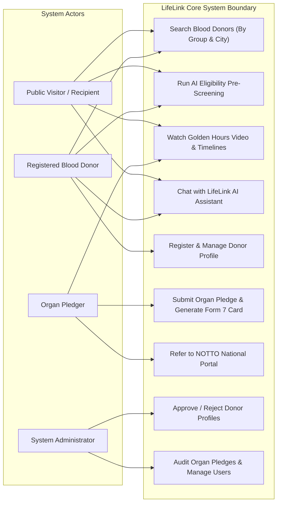
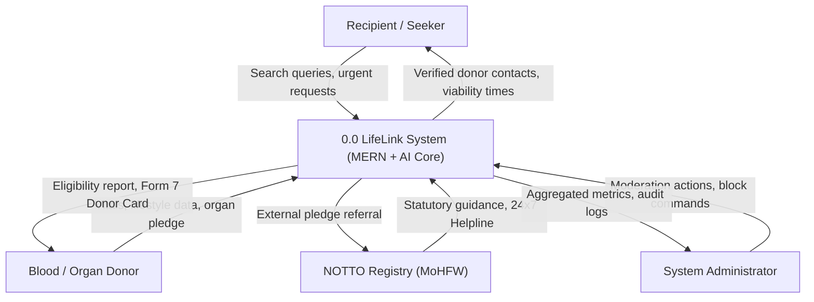
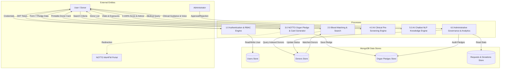
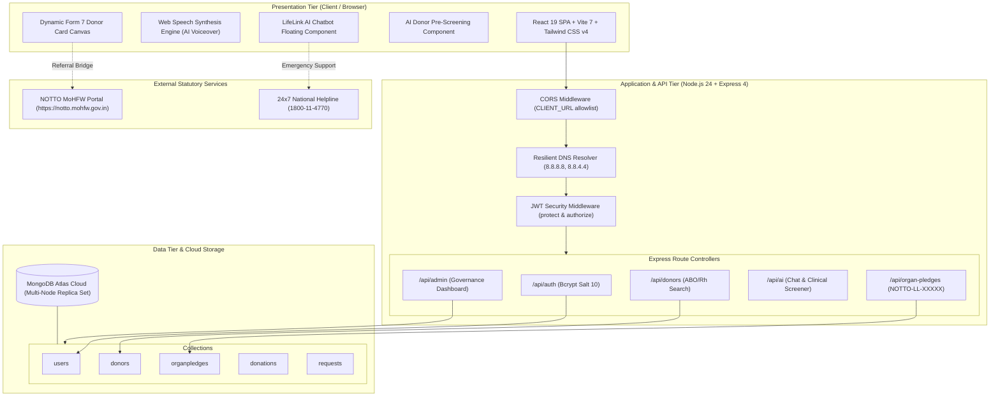
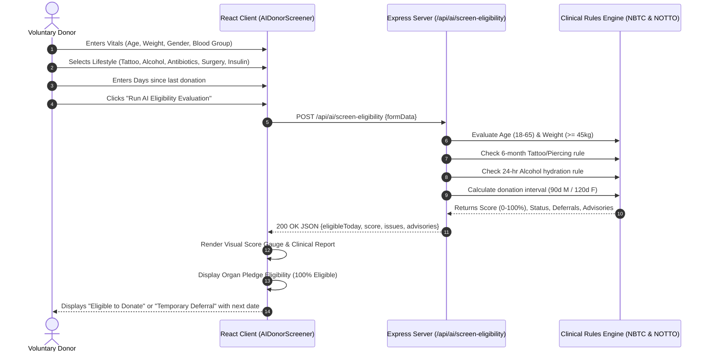
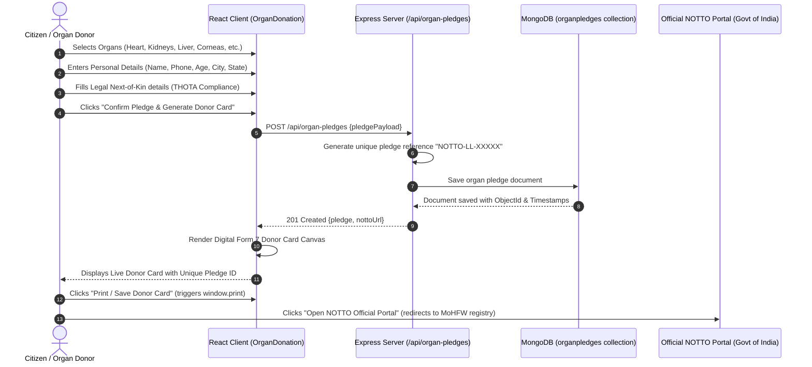
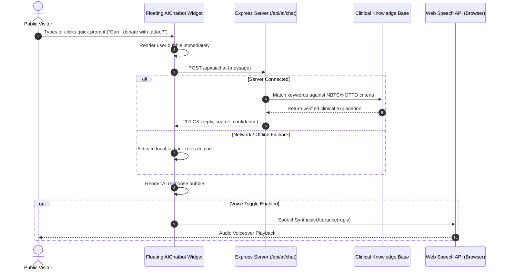
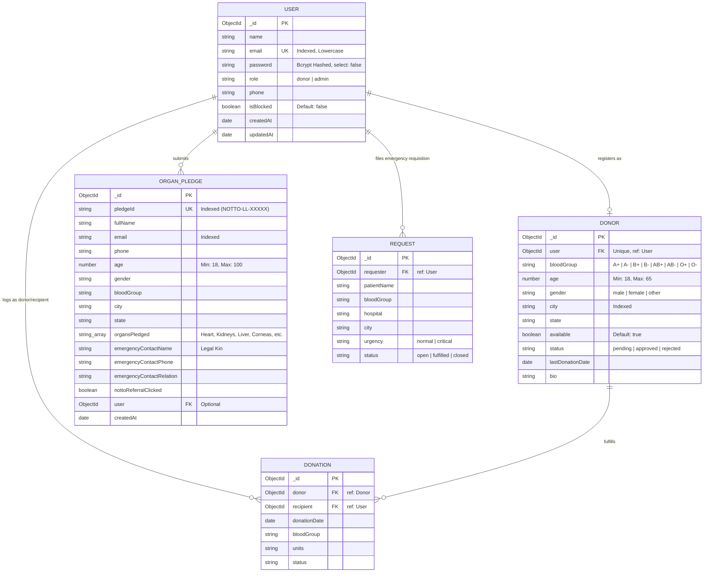
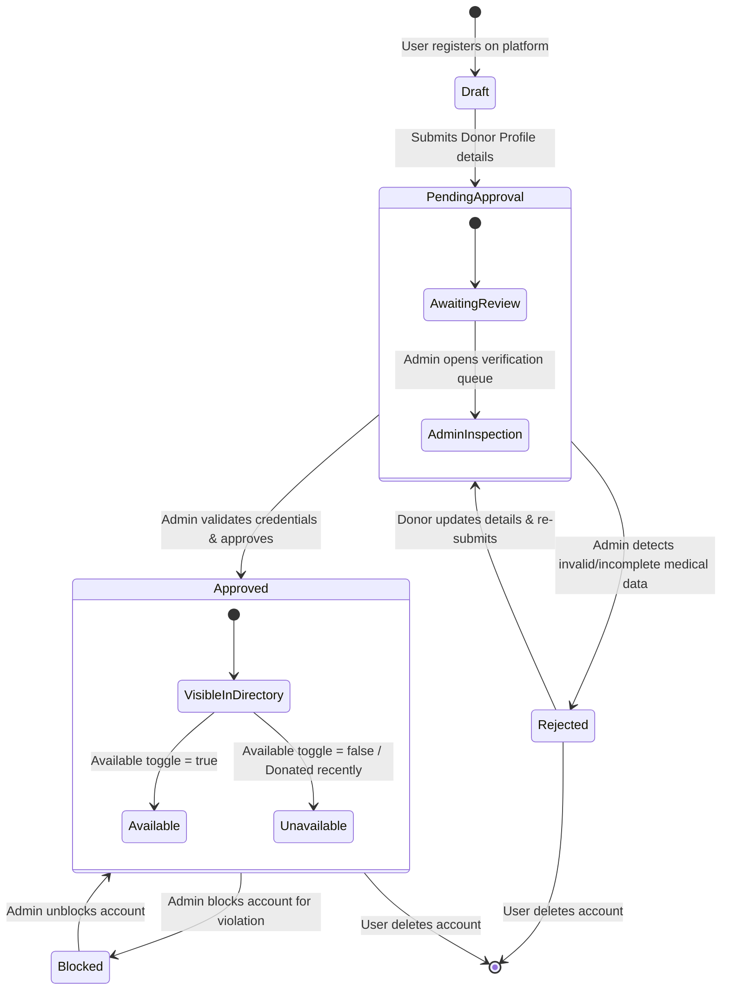

# System Architecture & SRS Diagrams
## LifeLink: AI-Powered Blood & Organ Donation Management System
### Integrated with NOTTO (MoHFW, Government of India)

---

**Document Version:** 1.0.0  
**Associated Document:** [SRS.md](file:///d:/Entri/main%20project/blood-donor-mern/blood-donor-mern/docs/SRS.md)  
**Standard:** IEEE Std 830-1998 Specification Diagrams  
**Architecture:** MERN (MongoDB Atlas, Express.js, React 19, Node.js 24)  

---

## Table of Diagrams
1. [Use Case Diagram (Actors & System Boundary)](#1-system-use-case-diagram)
2. [Level 0 Data Flow Diagram (Context Diagram)](#2-level-0-data-flow-diagram-context-diagram)
3. [Level 1 Data Flow Diagram (Detailed Process Decomposition)](#3-level-1-data-flow-diagram-dfd-level-1)
4. [Full-Stack 3-Tier System Architecture Diagram](#4-full-stack-3-tier-system-architecture-diagram)
5. [Sequence Diagram: AI Donor Eligibility Pre-Screening](#5-sequence-diagram-ai-donor-eligibility-pre-screening)
6. [Sequence Diagram: NOTTO Organ Pledge & Form 7 Card Generation](#6-sequence-diagram-notto-organ-pledge--form-7-card-generation)
7. [Sequence Diagram: LifeLink AI Assistant Query Resolution](#7-sequence-diagram-lifelink-ai-assistant-query-resolution)
8. [Entity-Relationship Diagram (ERD)](#8-entity-relationship-diagram-erd)
9. [State Transition Diagram: Blood Donor Profile Lifecycle](#9-state-transition-diagram-blood-donor-profile-lifecycle)

---

## 1. System Use Case Diagram
Visualizes the primary system actors (Public Recipient, Voluntary Blood Donor, Organ Pledger, and System Administrator) and their functional boundaries.

---

## 2. Level 0 Data Flow Diagram (Context Diagram)
Demonstrates the high-level boundary of LifeLink with external entities and data exchanges.

---

## 3. Level 1 Data Flow Diagram (DFD Level 1)
Decomposes internal processes, data stores, and message queues.

---

## 4. Full-Stack 3-Tier System Architecture Diagram
Illustrates the physical architecture across Client, Web Server, AI Services, and Cloud Data Tier.

---

## 5. Sequence Diagram: AI Donor Eligibility Pre-Screening
Traces the chronological interaction for donor pre-screening under NBTC and NOTTO criteria.

---

## 6. Sequence Diagram: NOTTO Organ Pledge & Form 7 Card Generation
Traces the organ pledge registration and instant printable donor card lifecycle.

---

## 7. Sequence Diagram: LifeLink AI Assistant Query Resolution
Demonstrates natural language medical query resolution, offline fallback, and SpeechSynthesis voice readout.

---

## 8. Entity-Relationship Diagram (ERD)
Defines the relational mappings, foreign keys, and indexes among MongoDB collections.

---

## 9. State Transition Diagram: Blood Donor Profile Lifecycle
Shows the state machine governing donor approval, public directory visibility, and administrative governance.

---

**Generated For:** LifeLink Healthcare Engineering Documentation  
**Review Status:** Verified & Baselined for Entri Main Project  
